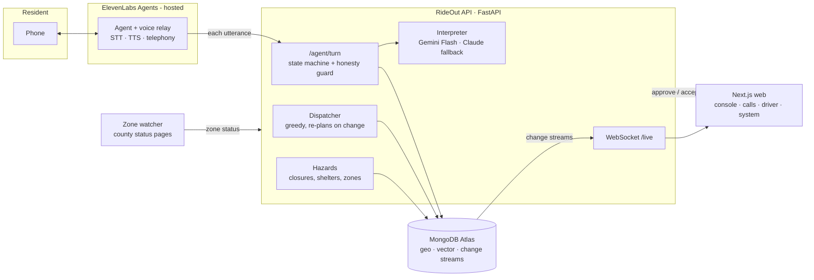

# RideOut

RideOut finds the people who can't leave a wildfire evacuation zone on their own and gives each of them a seat in a
neighbor's car or an agency van, the way a ride app matches riders and drivers.

When a zone goes to **SET**, RideOut calls every home in the zone at once, builds a live census of who needs a ride,
plans pickups against each home's fire deadline, and tracks the drivers it sends toward the fire. Nobody is told help
is coming until a driver has accepted.

---

## Contents
1. [How it works](#how-it-works)
2. [Architecture](#architecture)
3. [Tech stack](#tech-stack)
4. [Screens](#screens)
5. [Algorithms](#algorithms)
6. [Environments, branches, deploys](#environments-branches-deploys)
7. [Repo layout](#repo-layout)
8. [Run it locally](#run-it-locally)
9. [Configuration](#configuration)

---

## How it works

```
Zone goes to SET ─► call every home at once ─► census: who needs help / who can help / who's out
       │                                              │
 (zone watcher reads                                  ▼
  county status pages)               ride requests ─► dispatcher approves plan (1 click)
                                                      │
Fire map ─► deadline per home                         ▼
                                          driver accepts on phone ─► resident called back
                                                      │              with driver name + ETA
                                 driver safety: fire-closing-in, SOS, man-down
                                                      │
                     road closes / fire jumps ─► re-plan ─► resident told the truth at once
```

1. **Call everyone at SET, not GO.** A zone watcher reads the county's Ready / Set / Go pages. When a zone moves to
   SET, the voice agent calls every household in parallel, in English or Spanish.
2. **Build a live census.** Each call fills one household record: can everyone leave, how many people, mobility
   (walker, chair, bedbound), oxygen, pets, car, and how much help is needed.
3. **Silence is never "safe."** No answer → retry at 2 min → retry at 5 min → text → door-knock list.
4. **Plan pickups that can happen.** The dispatcher matches each request to a vehicle with the right seats,
   wheelchair space and crew, before that home's deadline. A human approves; each driver accepts or declines.
5. **The honesty rule is enforced in code.** Every sentence about a ride is a fixed template chosen by the
   request's status; the agent never says help is coming before a driver accepts.
6. **Close the loop.** When a driver accepts, the resident is called back with the driver's name, vehicle and ETA.
   If a road closes, the resident hears that at once and the request is re-planned.
7. **Protect the drivers.** The driver app shows fire distance, flags routes into the fire buffer, and sends SOS or
   MAN DOWN (impact, then stillness) with coordinates to the dispatcher.

## Architecture



The full walkthrough (flows, state machines, deployment, fallbacks) is in [`docs/ARCHITECTURE.md`](docs/ARCHITECTURE.md).
The database schema, status machine, API and event types are in [`docs/CONTRACT.md`](docs/CONTRACT.md).

**Rules every part follows:**
- **One database is the source of truth.** Services read and write MongoDB through the API; the UI listens on `/live`.
- **The AI only interprets; code decides.** The model turns speech into record fields. The state machine picks the
  next question and every status sentence.
- **Only `api/requests.py` changes a request's status**, and only along the legal transitions.
- **Accept is atomic.** If two drivers tap Accept at once, exactly one wins; the other sees "Assignment changed."

## Tech stack

| Layer | Choice |
|---|---|
| Voice and phone line | ElevenLabs Agents (Twilio/SIP number, Custom LLM relay) — `voice/` |
| Interpretation | Gemini Flash (JSON schema output), Claude as fallback (Anthropic API or Amazon Bedrock) |
| API | Python 3.12, FastAPI, Motor — `api/` |
| Database | MongoDB Atlas: geo queries, Vector Search (duplicate calls), change streams (`/live`) |
| Zone watcher | TinyFish fetch of county Ready / Set / Go pages |
| Web | Next.js 15, Tailwind 4, Zustand, MapLibre GL + react-map-gl + deck.gl, OpenFreeMap tiles (light/dark) — `web/` |
| Hosting | API: Docker on a Vultr VM behind Caddy (dev / staging / prod containers). Web: Vercel |
| CI/CD | GitHub Actions: lint + tests on every PR; image to GHCR and SSH deploy per branch |

## Screens

| Path | Who | What |
|---|---|---|
| `/` | Anyone | Try it: enter a phone number, tap a house, then either get called as that resident or join as a volunteer driver |
| `/console` | Dispatcher | Live map (fire, homes by status, vehicles, routes, closures), requests by deadline, plan to approve, fleet, door-knock list, safety alerts |
| `/calls` | Dispatcher | Every live call, its transcript and record filling in, latency per turn |
| `/driver` | Drivers (phone, PWA) | Offer cards → Accept/Decline → every rider + seats left → "Picked up". Addresses open in the map app. SOS (hold), man-down |
| `/driver/fleet` | Dispatcher / demo | Every driver's screen on one page, with their notifications as they happen |
| `/system` | Anyone | Under the hood: latency, honesty rate, dispatch vs. baseline (simulated), audit trail |
| `/drill` | Testing | A clearly labeled RideOut drill page with a test zone's Ready / Set / Go status, read by the zone watcher. Never styled as a county site |
| `/report` | Anyone | Photo hazard reports (not built yet) |

The UI follows the system theme (light or dark) and has a manual toggle. Anything simulated carries a "simulated" label.

## Algorithms

| Problem | Method | Where |
|---|---|---|
| Which vehicle picks up whom | Batched matching (Hungarian algorithm over pickup ETAs, like ride-hail dispatch), seats filled before the next vehicle, deadlines, wheelchair/lift needs, no rescuers inside the fire; accepted stops never move; re-plans every 5 s | `api/dispatch/` |
| Travel times | SR 89A polyline road model plus side streets | `api/sim/geo.py` |
| Duplicate calls | Embeddings + Atlas Vector Search, then a rule check (same address ±50 m) | `api/agent/dedupe.py` |
| Don't promise rescue | Status templates in code + an honesty guard on every agent line; evals over 40 personas | `api/agent/templates.py`, `api/agent/honesty.py`, `evals/` |
| Man-down | Impact above a threshold *g* (DeviceMotion), then 10 s stillness → "Are you OK?" → 20 s → MAN DOWN | `web/app/driver/safety.ts` |
| Impact estimate | Same simulated homes, fire and fleet run as a 911 queue vs. RideOut dispatch | `api/sim/compare.py`, [`docs/simulation.md`](docs/simulation.md) |

## Environments, branches, deploys

| Env | Branch | Web | API | Database |
|---|---|---|---|---|
| Development | `develop` | Vercel (branch deploy) | `api-dev` container | Atlas `rideout_dev` |
| Staging | `staging` | Vercel (branch deploy) | `api-staging` container | Atlas `rideout_staging` |
| Production | `main` | Vercel (production) | `api` container | Atlas `rideout_prod` |

- Work happens on `feat/<slug>` or `fix/<slug>` → PR into `develop`. CI runs lint + tests on every PR.
- Releases are PRs `develop → staging`, then `staging → main`. A merge deploys that environment.
- `GET /health` returns `{env, version, gitSha}`.
- Details: [`CONTRIBUTING.md`](CONTRIBUTING.md), [`infra/README.md`](infra/README.md). Rules for coding agents: [`AGENTS.md`](AGENTS.md).

## Repo layout

```
rideout/
├─ docs/
│  ├─ ARCHITECTURE.md      ← how the system fits together
│  ├─ CONTRACT.md          ← DB schema, status machine, API, events
│  ├─ simulation.md        ← impact simulation: settings, models, results
│  └─ sources.md           ← primary sources for the scenario and population data
├─ api/                    ← FastAPI (Python 3.12)
│  ├─ main.py  core/  models/  requests.py  assignments.py  callbacks.py  routes/
│  ├─ agent/    (turn state machine, interpreter, templates, honesty guard, dedupe, dialer, zone watcher)
│  ├─ dispatch/ (greedy solver, solve loop)
│  ├─ sim/      (simulated households, drivers, road model, impact comparison)
│  └─ tests/
├─ voice/                  ← ElevenLabs custom-LLM relay (thin client → /agent/turn)
├─ web/                    ← Next.js app (kiosk, console, calls, driver, system, drill)
├─ evals/                  ← persona runs, honesty + accuracy results
├─ data/                   ← scenario.json, personas.json, population.md, sim-results.json, eval-results.json
├─ infra/                  ← docker-compose, Caddyfile, VM bootstrap and deploy scripts
└─ .github/workflows/      ← ci.yml, deploy.yml
```

## Run it locally

```bash
cp .env.example .env            # fill in keys (see Configuration)
# Local MongoDB as a replica set (change streams for /live need one), or point MONGODB_URI at Atlas.
docker compose -f infra/docker-compose.local.yml up -d   # MONGODB_URI=mongodb://localhost:27017/?directConnection=true
# API: run from the REPO ROOT. The package is `api`, so `api/requests.py` never shadows the `requests` library.
uv sync --project api && uv run --project api uvicorn api.main:app --reload --port 8000   # docs at :8000/docs
# Tests + lint
cd api && uv run ruff check . && uv run ruff format --check . && uv run pytest -q && cd ..
# Web
cd web && pnpm i && pnpm dev     # http://localhost:3000, NEXT_PUBLIC_API_URL=http://localhost:8000
# Seed the scenario + simulated households and vehicles
curl -X POST "localhost:8000/sim/seed?scenario=pocket-fire"
# Voice relay (ElevenLabs Custom LLM; agent setup in voice/README.md)
cd voice && uv sync && uv run python main.py   # :8080/v1/chat/completions
```

Endpoints that aren't built yet return **501** `not implemented yet`.

## Configuration

All configuration comes from environment variables; see [`.env.example`](.env.example). The main ones:

| Variable | What |
|---|---|
| `ENV` | `dev` / `staging` / `prod`; picks the database name |
| `MONGODB_URI` | Atlas or local replica set |
| `GEMINI_API_KEY`, `GEMINI_MODEL` | Interpreter |
| `CLAUDE_PROVIDER`, `ANTHROPIC_API_KEY` or `AWS_*` | Claude fallback (Anthropic API or Bedrock) |
| `ELEVENLABS_API_KEY`, `ELEVENLABS_AGENT_ID`, `ELEVENLABS_PHONE_NUMBER_ID`, `ELEVENLABS_TELEPHONY` | Outbound calls |
| `TINYFISH_API_KEY`, `COUNTY_PAGE_URL`, `PUBLIC_WEB_URL` | Zone watcher |
| `INTERNAL_TOKEN` | Shared secret between the voice agent and the API |
| `NEXT_PUBLIC_API_URL` | Web → API base URL |
| `CORS_ORIGINS` | Allowed web origins |

**Never commit `.env`.** Secrets live in GitHub Environments and in the server's env files.
