# RideOut: architecture

This document explains how the whole system fits together: what each part does, how data moves, what happens at every step of a rescue, how we deploy, and what to do when something fails. Read it once end to end before you start. Exact field names and endpoints live in [`CONTRACT.md`](CONTRACT.md). Who builds what lives in [`team/`](team/).

---

## 1. The system in one minute

RideOut works like a ride app for an evacuation.

- **Riders** are people who can't leave on their own: older adults, wheelchair users, people on oxygen, people without a car.
- **Drivers** are agency vans and neighbors who are already leaving and have a spare seat.
- **The dispatcher** is a person at the emergency operations center who approves the plan.

Ride apps wait for riders to open the app. RideOut **calls every home** in the danger zone the moment it moves to **SET**. It learns who needs a ride and who can give one, and keeps every promise honest while the fire changes the plan.

```
SET ─► call everyone ─► census ─► ride requests ─► plan ─► dispatcher approves ─► driver accepts ─► resident called back
                                         ▲                                                 │
                    fire / road closure ─┴──────────── re-plan ◄── driver can't get through ─┘
```

Five rules hold the whole design together:

1. **One database is the truth.** Everything reads and writes MongoDB through the API. Nothing calls another part's internals.
2. **The AI interprets. Code decides.** Gemini turns speech into structured fields. A state machine chooses what happens next.
3. **Promises live in code.** Anything said about a ride comes from a fixed template chosen by the ride's status. Nobody hears "help is coming" until a driver has accepted.
4. **Silence is never safe.** An unanswered home is retried, texted, and finally put on a door-knock list.
5. **Accepted rides don't move.** Re-planning never takes an accepted pickup away from a driver unless no route can reach it in time.

---

## 2. Who uses it

| Actor | Device | Screen / channel | What they do |
|---|---|---|---|
| Resident | Any phone, including a landline | Phone call (ElevenLabs) | Answers questions, hears honest updates |
| Dispatcher | Laptop | `/console`, `/calls` | Watches the map, approves plans, closes roads, reads safety alerts |
| Driver | Smartphone | `/driver` (PWA) | Accepts offers, follows the run, confirms pickups, sends SOS |
| County | Public web page | Ready/Set/Go status | Changes zone status (posts it to the RideOut webhook) |
| Visitor | Phone + laptop | `/` kiosk, `/system` | Gets called as a resident, inspects the numbers |

---

## 3. System context

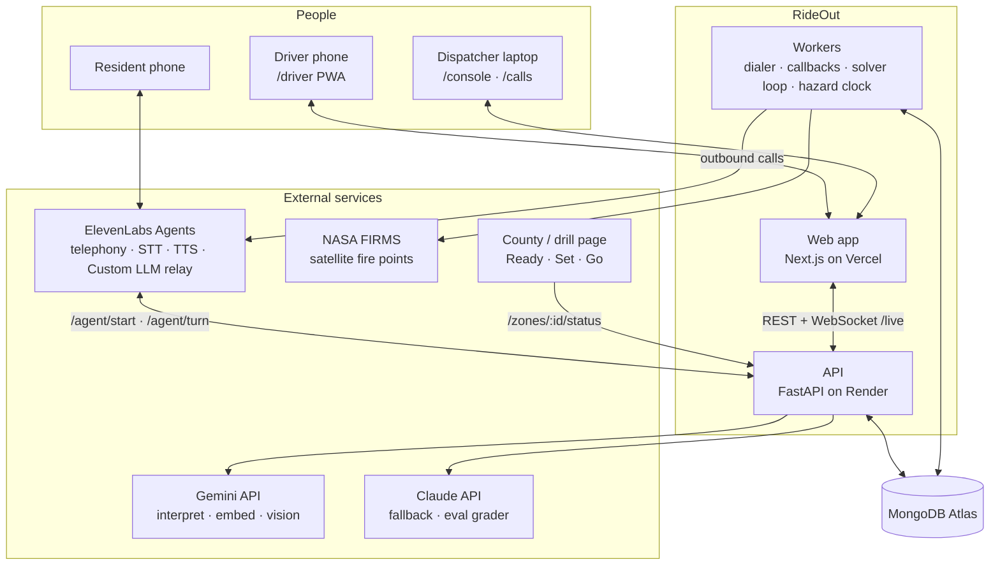

---

## 4. Components

| Component | Responsibility | Tech | Folder |
|---|---|---|---|
| **Voice agent** | Runs the phone call. Sends each utterance to the API and speaks back what the API returns | ElevenLabs Agents + Custom LLM relay (Python, FastAPI) | `voice/` |
| **Agent service** | Turn handling: interpreter → state machine → templates → honesty guard → `say[]` | FastAPI, Gemini, Claude | `api/agent/` |
| **Dialer + reach ladder** | Calls homes in priority order, retries, texts, door-check list | asyncio worker | `api/agent/dialer.py` |
| **Callback worker** | Calls residents when their ride status changes | asyncio worker | `api/agent/callbacks.py` |
| **Zone status** | County webhook and drill page set Ready/Set/Go; calls start at SET | FastAPI | `api/routes/zones.py`, `api/agent/zone_status.py` |
| **Core rules** | Request status machine, offers, atomic accept, expiry, audit log | FastAPI, Motor | `api/requests.py`, `api/routes/assignments.py` |
| **Live hub** | Turns Mongo change streams into WebSocket events | FastAPI WebSocket | `api/live.py` |
| **Dispatcher (solver)** | Plans which vehicle picks up whom, re-plans on change | Python | `api/dispatch/` |
| **Hazard service** | Fire front, arrival time per home, automatic road closures | Python (NumPy, Shapely) | `api/hazard/` |
| **Simulator** | 200 stand-in homes, drivers, fire clock, impact comparison | Python | `api/sim/` |
| **Console** | Dispatcher map, requests, plan approval, closures, alerts | Next.js, MapLibre, deck.gl | `web/app/console/` |
| **Driver app** | Offers, run, GPS, pickup confirmation, SOS, man-down | Next.js PWA | `web/app/driver/` |
| **Call floor** | Live transcripts and records | Next.js | `web/app/calls/` |
| **System page** | Metrics, evals, audit trail | Next.js | `web/app/system/` |
| **Evals** | Persona calls, Claude grader, accuracy and honesty numbers | Python | `evals/` |

---

## 5. Data model

Full fields in [`CONTRACT.md` §1](CONTRACT.md#1-mongodb-collections). This is how the collections relate.

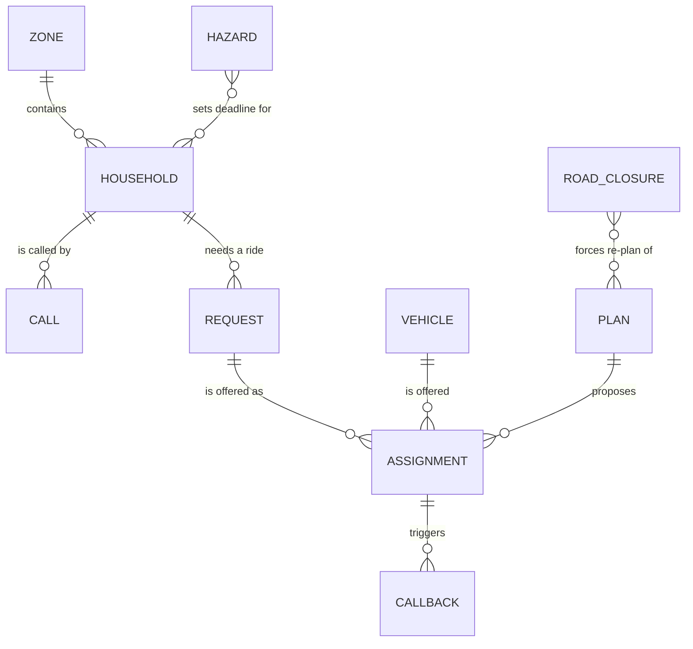

- **Household:** one home. Its `record` is what we learned on the call. Its `role` drives the map color: red needs a ride, amber can help, green has left, grey not reached yet.
- **Request:** one ride need. It has a status (see §7.1) and a `need` vector: seats, wheelchair spaces, stretcher, crew size, lift.
- **Assignment:** one offer of one request to one vehicle in one plan version. Only one assignment per request can be live at a time.
- **Callback:** one phone call we owe a resident because their ride status changed. The unique key `request:assignment:status` makes callbacks idempotent.
- **Plan:** one run of the solver (version, solver used, solve time, offers that changed).

**MongoDB** holds the state and the call turns. The fire replay is computed from the seeded run, so it needs no separate store.

---

## 6. Key flows

### 6.1 The zone goes to SET → everyone gets called

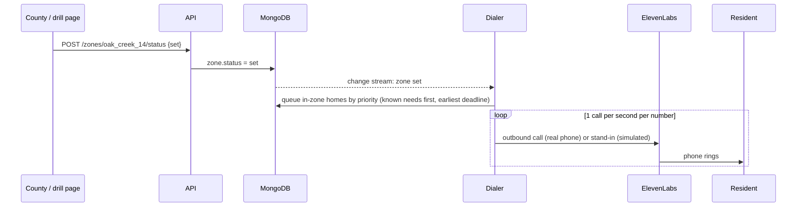

- Real calls go only to real phone numbers someone entered (kiosk or test). The other ~200 homes are **stand-ins**: they run the same agent over text, replying with persona scripts, so the census fills for real.
- Each phone number places at most one outbound call per second (Twilio default). A real deployment adds more numbers to go faster.

### 6.2 One turn of a call

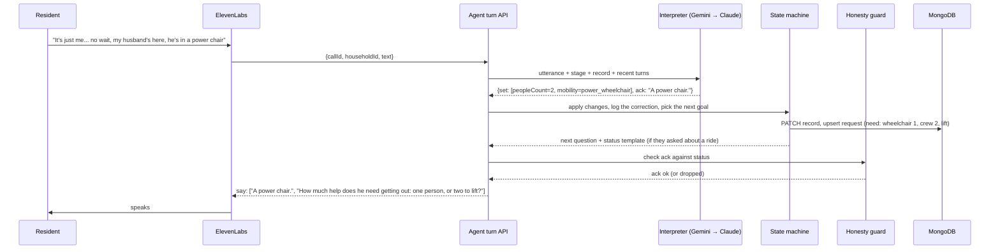

**What each layer is allowed to do:**

| Layer | Can | Can't |
|---|---|---|
| Interpreter (AI) | Turn speech into field changes, detect emergencies, write a ≤ 6-word acknowledgment | Choose the next question. Say anything about a ride. Use numbers |
| State machine (code) | Pick the next question, decide when to read back, create requests, escalate | Make up facts |
| Templates (code) | Every sentence about ride status, ETA, driver name | — |
| Honesty guard (code) | Drop an acknowledgment that sounds like a promise or contains digits | — |

**Latency budget per turn:** interpreter ≤ 1.0 s at p50. If Gemini hasn't answered in 2.5 s, the same prompt goes to Claude Sonnet. Database writes and events are fire-and-forget. Each turn's latency is logged on the call in MongoDB.

### 6.3 Request → plan → approve → accept → callback (the happy path)

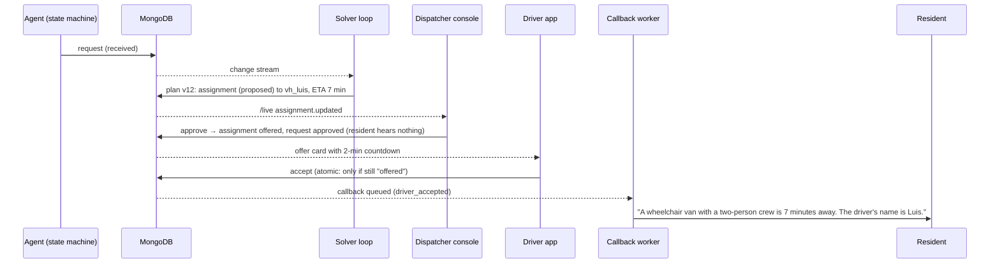

- **Approval is not a promise.** It changes nothing the resident hears.
- **Atomic accept:** `find_one_and_update({_id, status: "offered"}, {$set: {status: "accepted"}})`. If two phones tap Accept at once, exactly one wins and the other gets `{"result": "changed"}`.
- Offers expire after 2 minutes, and the request goes silently back to `received`.

### 6.4 The fire closes the road → revoke → tell the truth → reassign

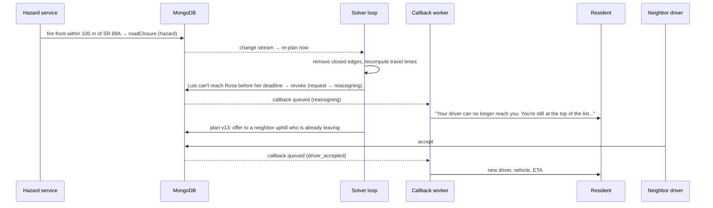

- Only the pickup that can't be reached is revoked. **The rest of Luis's run stays exactly as he accepted it.**
- A late tap on the old offer gets "Assignment changed" on the driver's screen and in the audit log.

### 6.5 Driver safety: man-down and SOS

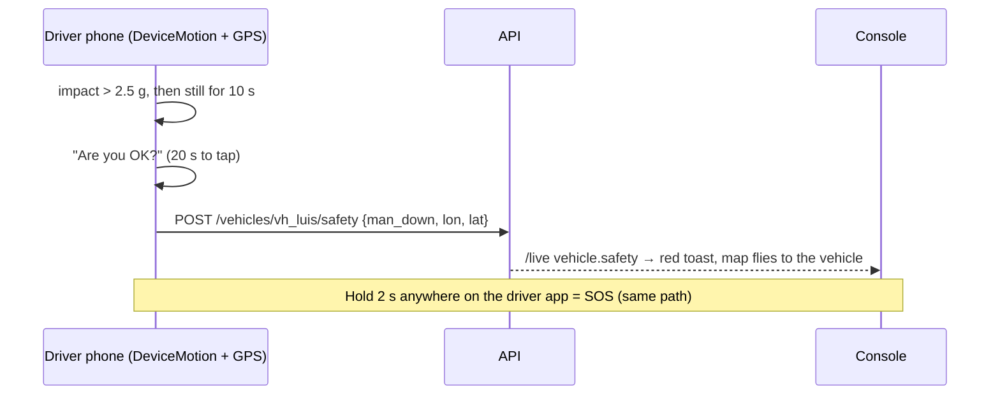

The driver app also shows "Fire 400 m NE · closing in" and warns if the route passes within 300 m of the fire front.

### 6.6 Hazard pipeline: from satellites to deadlines

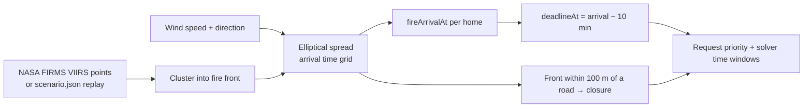

---

## 7. State machines

### 7.1 Ride request

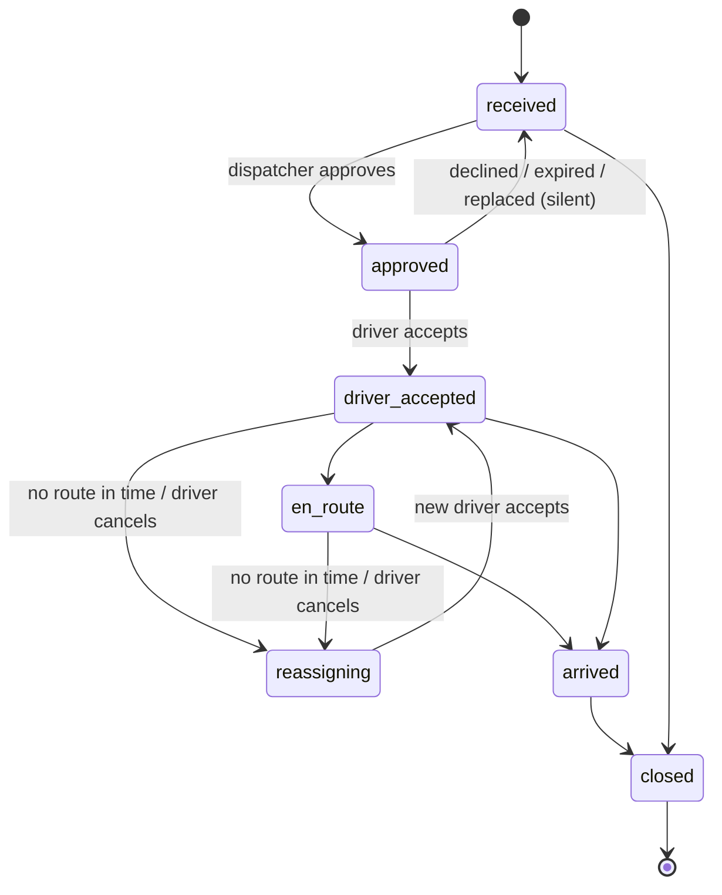

Only `api/requests.py: transition()` changes this status. Any other move raises an error, and every move is written to the audit log.

### 7.2 Reaching a household (the reach ladder)

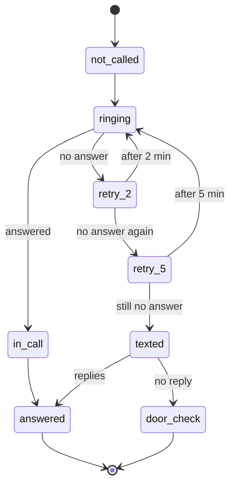

### 7.3 Offer (assignment)

`proposed → offered → accepted → completed`, with side exits `declined`, `expired`, `replaced` (new plan, silent) and `revoked` (accepted but unreachable: the resident is told).

### 7.4 Driver safety

`ok → check` (impact, then stillness) `→ man_down` (no tap in 20 s). `ok → sos` (hold 2 s). Any tap goes back to `ok`.

---

## 8. Real-time layer

- The API opens one **MongoDB change stream** per collection we broadcast and turns each change into a `{type, data, at}` event on **`/live`** (WebSocket).
- The web app keeps one socket open (`web/lib/live.ts`) and writes events into a Zustand store per collection. Components render from the store, so the map, lists, and counters all move together.
- `vehicle.moved` is throttled to at most 2 events per second per vehicle.
- If the socket drops, the client reconnects with backoff and re-fetches the current state over REST, so nothing is missed.

---

## 9. AI layer

| Job | Model | Why |
|---|---|---|
| Interpret each utterance | **Gemini Flash** (`GEMINI_MODEL`) with a JSON schema | Fast, cheap |
| Backup interpreter | **Claude Sonnet 5.5** | Gemini slower than 2.5 s or failing |
| Photo hazard reports (not built) | **Gemini** vision | Reads smoke, flames, blocked roads in a photo |
| Duplicate detection | **Gemini embeddings** + Atlas Vector Search | Same household reached by several callers |
| Eval grader | **Claude Opus 5.5** | Grades every agent line against the call-taker principles |

**Why honesty lives in code, not the prompt:** an AI under pressure ("please, is someone coming?") reaches for comfort, and "help is on the way" is the exact sentence that can kill someone who would otherwise have left on their own. So the AI never writes status sentences. Templates do. A regex guard drops any AI acknowledgment that sounds like a promise while no driver has accepted, and a Claude grader measures what slips through. This follows the *Constitutional AI* idea (Bai et al., 2022): written principles plus a model that judges outputs against them. Because we can't train the model, the principles steer it through the prompt, and code enforces the one rule that must never break.

**Evals** (`evals/`): 40 persona calls in English and Spanish run through `/agent/turn`. We report per-field accuracy (address, people, mobility, assistance), the share of correct corrections, implied-promise rate according to the grader, and latency p50/p95. Results go to `/system`.

---

## 10. Dispatch algorithm

**Problem:** a dynamic dial-a-ride problem. Vehicles have capacities (seats, wheelchair, stretcher), crew sizes, and lifts. Each request has a pickup, any shelter with room as its drop-off, a need vector, and a deadline. New requests keep arriving, roads close, and accepted runs can't change.

**Greedy (built; always on as the fallback):**
1. Sort open requests by deadline (riders being reassigned first).
2. For each, find compatible vehicles. Insert the pickup after the vehicle's last accepted stop, and choose the one that reaches them soonest.
3. Requests nobody can reach in time wait until everyone reachable is placed, then escalate as `unservable`.

**OR-Tools (planned, not built):** a pickup-and-delivery routing model with time windows (deadline), three capacity dimensions, compatibility as allowed-vehicle sets, each request optional with a large drop penalty, and accepted stops fixed. Solve limit is 3 s, warm-started from the greedy plan.

**Objective (in order of weight):** missed deadlines (priced so one late rider outweighs any amount of driving) → need-weighted waiting → total driving time → churn of open offers.

**When it re-plans:** every 5 s while requests or offers are open, every 30 s otherwise, and immediately on a road closure or a correction that changes a need.

**Impact comparison** (`api/sim/compare.py`): identical households, fire, and fleet, 50 seeds. We compare **today** (riders call 911 themselves, first come first served, nearest unit, one household per trip), **RideOut + greedy**. (OR-Tools is reported as not available.) We report the median and range of riders boarded at least 10 minutes before the fire; settings and results are in [`simulation.md`](simulation.md). It's labeled "simulated" everywhere.

---

## 11. Hazard model

- **Input:** NASA FIRMS VIIRS active-fire points (375 m) for the area, or the Pocket Fire timeline in `data/scenario.json` replayed on a fast clock.
- **Spread:** each front point grows as an ellipse stretched downwind (Huygens' principle, the idea behind FARSITE). Rate of spread rises with wind speed. We march the front over a grid to get an arrival time per cell.
- **Outputs:** `fireArrivalAt` for every home, `deadlineAt = arrival − 10 min`, and automatic `hazard` road closures when the front comes within 100 m of a road segment.
- **Honesty:** the console says "scenario input, not a forecast." Satellite points are coarse and delayed, so we never claim the model predicts the fire at an individual house.

---

## 12. What's real and what's simulated

| Real | Simulated (labeled "SIM") |
|---|---|
| A visitor's phone call, speech, interpretation, record, honesty guard | The other ~200 households (same agent, persona replies) |
| Dispatcher approval, driver accept on a real phone, callback call | 7 of the 8 vehicles and their movement |
| Road graph of Sedona / Oak Creek Canyon (OpenStreetMap) | The fire timeline (built from the real Pocket Fire record) |
| Atomic accept, revoke, reassignment | The "today" baseline in the impact comparison |

---

## 13. Deployment

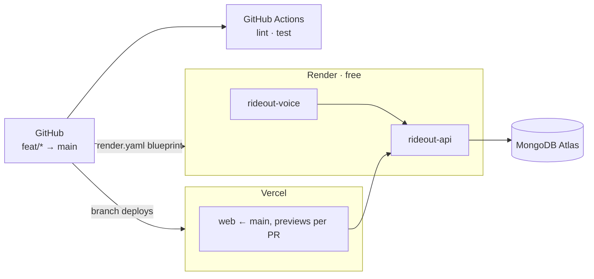

- `GET /health` returns `{env, version, gitSha}`. Check it after every deploy.
- Secrets live in GitHub Environments and the Render dashboard, never in git.
- Rollback: redeploy an earlier commit from the Render dashboard.

---

## 14. Failure modes and fallbacks

| What fails | What happens | How we see it |
|---|---|---|
| Gemini slow (> 2.5 s) or down | Claude Sonnet answers the same prompt | `fallback=true` on the turn, `/system` counter |
| Both AIs down | The state machine re-asks with fixed wording. The call still moves forward on yes/no | Turn logged `interpreter=none` |
| ElevenLabs call fails or no answer | Reach ladder: retry 2 min, retry 5 min, text, door-check | `reach` on the household, call-floor badge |
| OR-Tools slow or crashes | The greedy plan is used | `plans.solver = greedy` |
| WebSocket drops | Client reconnects and re-fetches over REST | Connection dot in the top bar |
| FIRMS unavailable | Replay from `scenario.json` | "Scenario replay" chip on the map |
| Two drivers accept at once | Exactly one wins. The other sees "Assignment changed" | Audit log `stale_accept_rejected` |
| Duplicate callback | Unique key ignores it | Audit log entry |

---

## 15. How this scales

- **Calls:** voice agents are stateless per turn, so more calls means more ElevenLabs concurrency and more phone numbers (each number places 1 call per second). The API scales horizontally behind a load balancer.
- **Data:** one incident per zone document set. Shard by incident in a real deployment. Atlas change streams keep every screen in sync without polling.
- **Solver:** one solver per zone, re-solving in seconds. Zones are independent, so they run in parallel.
- **Agencies:** each agency runs its own instance on its own rider list. The dispatcher always approves, so the agency stays in control.

---

## 16. Security and privacy

- Simulated households use **fictional people only**. Real rider data would belong to the agency, under its authority.
- `/agent/*` and webhooks need a shared bearer token. The driver app identifies the vehicle by link; a real deployment would add sign-in.
- Phone numbers and transcripts would be deleted a fixed time after an incident closes (not built yet).
- No individual risk scores are shown on screen. The door-knock order uses a transparent score, and nobody is skipped.

---

## 17. Glossary

| Term | Meaning |
|---|---|
| **Ready / Set / Go** | Arizona's evacuation levels: be ready, get set to leave, go now |
| **Census** |
| **Request** | One ride need for one household |
| **Assignment / offer** |
| **Callback** | A call we owe a resident because their ride status changed |
| **Stand-in** |
| **Reach ladder** | Call → retry 2 min → retry 5 min → text → door-check |
| **Frozen run** |
| **Deadline** | 10 minutes before the fire is expected at a home |
